<div align="center">

  

  <h1>ESP32-DIV V2</h1>

  <h3>Multi-band wireless research platform &mdash; SilentFOX Edition</h3>

  <p><strong>Firmware v1.9.0 &middot; DroneX 2.1.0 &middot; ESP32-S3</strong></p>

  <p>
    <a href="https://github.com/silentfox2023/ESP32-DIV/releases/latest"></a>
    
    
    
  </p>

  <h3><a href="https://github.com/silentfox2023/ESP32-DIV/releases/latest">Download the latest firmware</a></h3>

  <p>
    <a href="#feature-overview">Feature overview</a> &middot;
    <a href="#screenshots">Screenshots</a> &middot;
    <a href="#flashing">Flashing</a> &middot;
    <a href="#quick-start">Quick start</a>
  </p>

</div>

> **Legal notice:** ESP32-DIV is intended for **education, research, and authorized testing only**. Radio regulations differ by country. Operate only on devices, networks, and frequencies you own or have written permission to test. Unauthorized use may violate local law. You are responsible for your own compliance.

---

## Overview

ESP32-DIV V2 is a handheld multi-band wireless laboratory built around the **ESP32-S3**. It combines Wi-Fi, Bluetooth Low Energy, 2.4 GHz (nRF24), Sub-GHz (CC1101), and infrared in one touchscreen device, with optional RFID/NFC and GPS modules.

This SilentFOX edition adds a dedicated **drone Remote ID (RID)** toolchain, including support for the Chinese **GB 46750-2025** standard that became mandatory on 2026-05-01, plus the **DroneX** monitoring platform and the **HaleHound** wireless experiment suite.

- **Main processor:** ESP32-S3, 16 MB flash, 8 MB OPI PSRAM
- **Display:** 2.8-inch ILI9341 touchscreen (240 x 320) with five physical buttons
- **Radios:** Wi-Fi 2.4 GHz, BLE 5.0, 3 x nRF24, CC1101 Sub-GHz, IR transmit/receive
- **Optional:** PN532 RFID/NFC (SPI), GNSS module
- **Feedback:** 4 x WS2812 RGB LEDs, buzzer, IP5306 battery management with live voltage and charge state
- **UI languages:** English on-device UI and English DroneX Web UI (localized variants exist for some companion screens)

---

## Feature overview

| Menu | Capabilities |
| --- | --- |
| **WiFi** | Packet Monitor, Wi-Fi Scanner, Beacon Spammer, WiFi Deauther, Deauth Detector, Captive Portal, Probe Flood, Hidden SSID Revealer, WPS Scanner, ARP Scanner, Karma Attack |
| **2.4GHz** | 2.4 GHz Scanner, Proto Kill, ESB Sniffer, ESB Replay, MouseJack Scan, MouseJack Inject |
| **Bluetooth** | BLE Scanner, BLE Sniffer, BLE Spoofer, Sour Apple, BLE Jammer, BLE Rubber Ducky, AirTag Spoofer, AirTag Sniffer, Skimmer Detect |
| **SubGHz** | Replay Attack, Sub-GHz Jammer, Saved Profiles, De Bruijn / Brute Force, Jamming Detector |
| **More** | IR remote tools, RFID/NFC (8 tools), GPS tools, **Drone** submenu (4 tools), HaleHound (14 modules) |
| **DroneX** | Continuous BLE + Wi-Fi Remote ID detection, target tracking, alerts, black/white lists, SD track logs, browser dashboard |
| **Tools** | Serial Monitor, Update Firmware (Web OTA / SD), Touch Calibrate, SD File Manager |
| **Settings / About** | Theme, brightness, NeoPixel effects, background auto-scan, persistent settings, version and credits |

### Drone Remote ID

| Tool | Location | Purpose | Access |
| --- | --- | --- | --- |
| **RID Scanner** | More > Drone | Fast, zero-configuration RID detection over Wi-Fi channels 1-13 and BLE | Device MAC whitelist |
| **RID Spoof** | More > Drone | Multi-protocol RID transmitter simulating up to 12 drones | Device MAC whitelist |
| **Drone Deauth** | More > Drone | Selective deauthentication against Wi-Fi drone control links | Device MAC whitelist |
| **Drone Jelly** | More > Drone | 2.4 GHz carrier / sweep confined to 2400-2525 MHz | Device MAC whitelist |
| **DroneX** | Main menu | Flagship continuous detection and management platform | Paid ECDSA license |

All RID tools decode **ASTM F3411**, **GB 46750-2025**, and **DJI proprietary DroneID**, covering current DJI models, older DJI aircraft, and other compliant manufacturers.

### HaleHound

HaleHound bundles 14 wireless experiment modules behind a single menu: Radio Test, IOT Recon, Deauther, Auth Flood, Stations, Predator, WhisperPair, Airoha Race, SkeletonKey, Scream, Guardian, Spectrum, EAPOL Capture, and RFID Classic.

---

## Screenshots

### Main menu

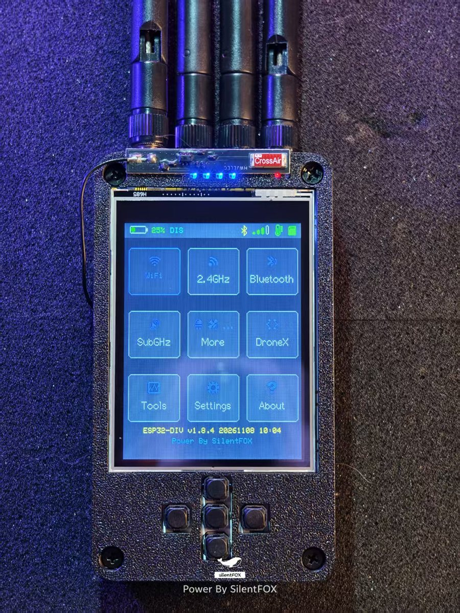

*Main menu of the current firmware. DroneX occupies the third row, first tile; Drone and HaleHound are reached from the More menu.*

### Tools menu

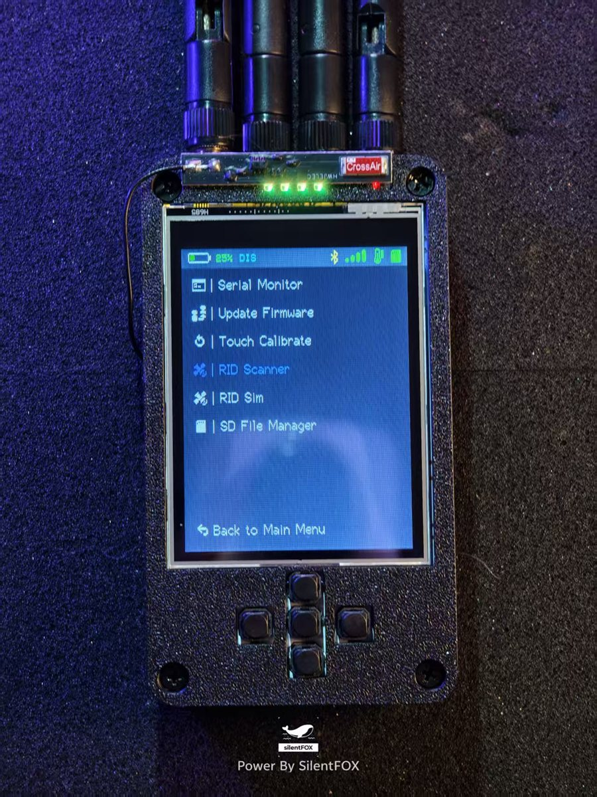

*Tools menu: serial monitor, firmware update, touch calibration, and the SD card file manager. In v1.9.0 the two RID tools are no longer here; they moved to More > Drone.*

### HaleHound module list

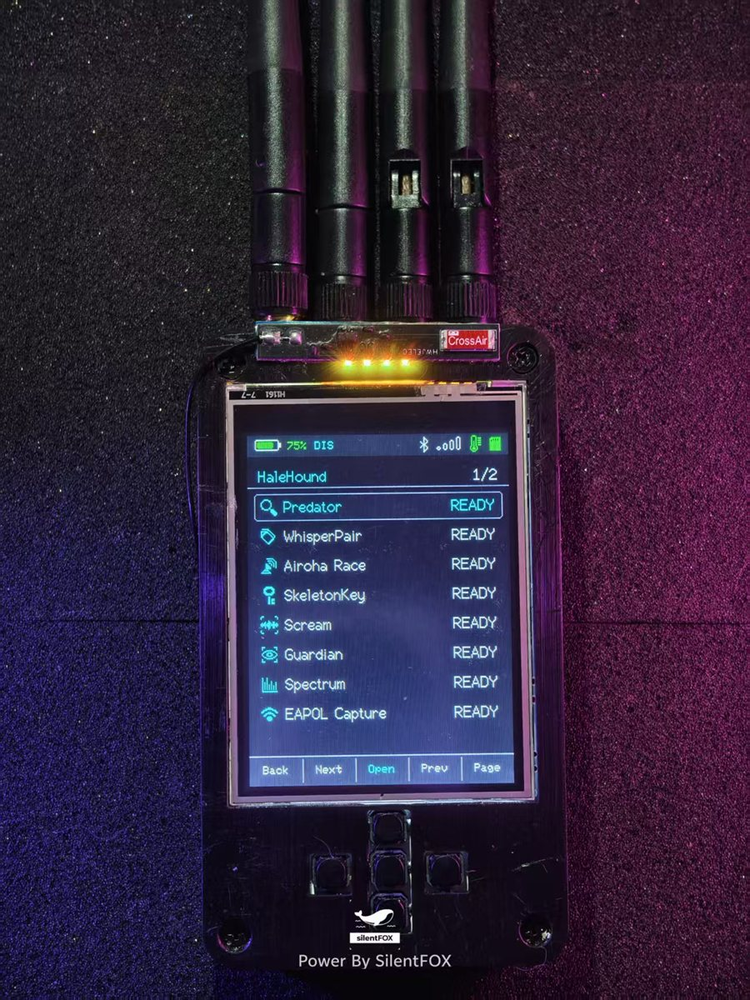

*HaleHound module list. Every module reports READY from the shared list; the Stations scanner is the newest entry.*

### Scream

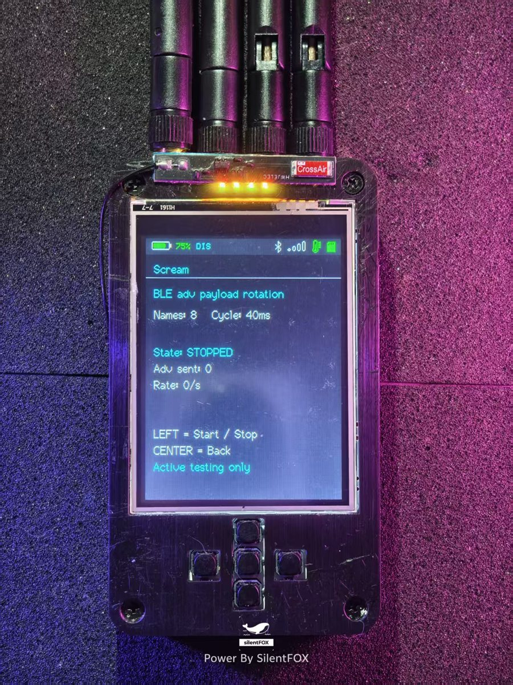

*Scream rotates BLE advertisement payloads and device names (8 names, 40 ms cycle). It does not perform MAC flooding.*

### Guardian

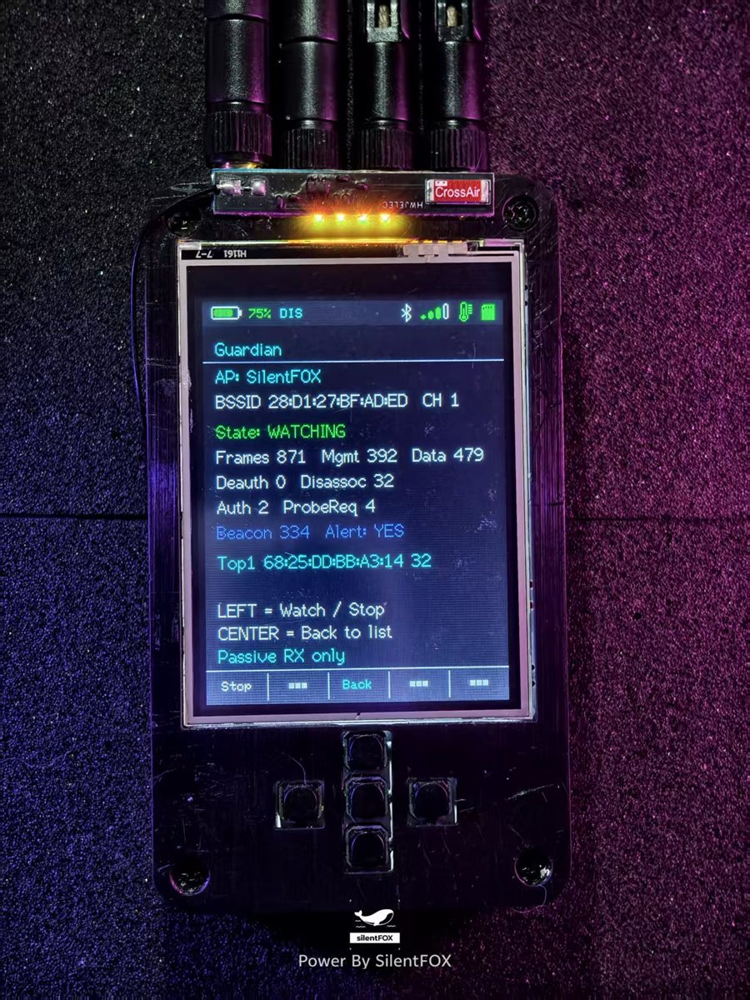

*Guardian locks onto one access point channel and counts management, data, deauthentication, and disassociation frames. It is receive-only.*

### Spectrum

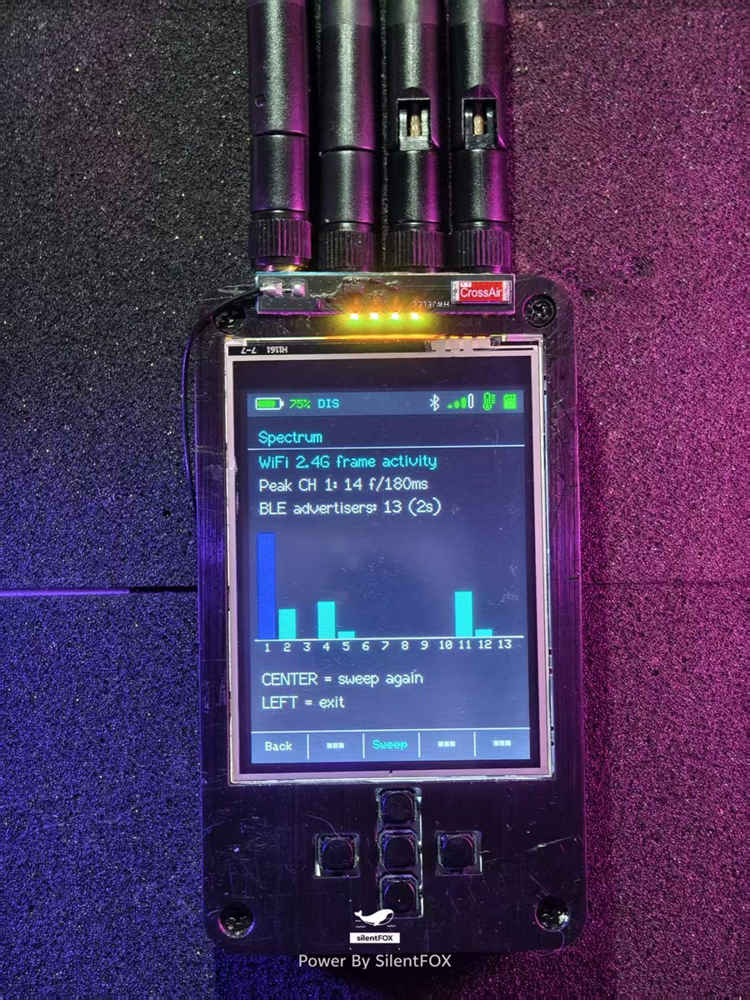

*Spectrum sweeps channels 1-13 and charts the number of 802.11 frames per channel, plus nearby BLE advertisers.*

### Radio Test

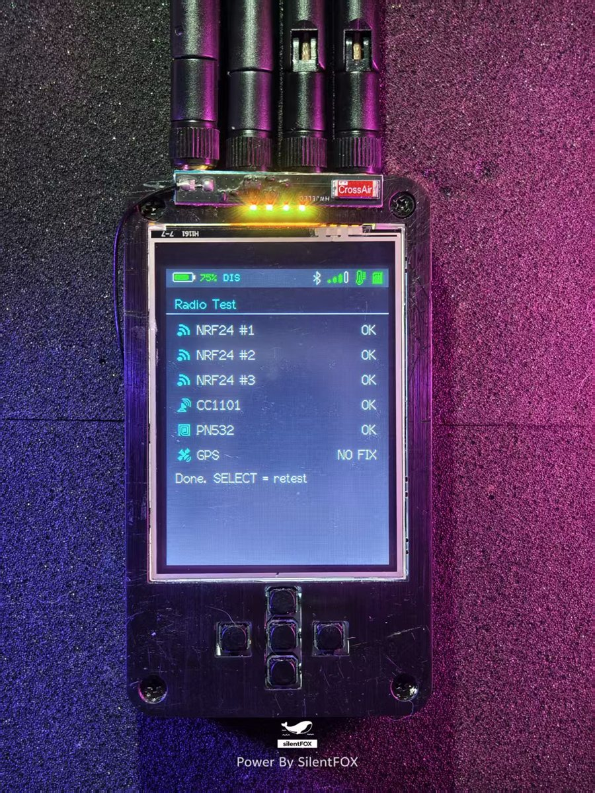

*Radio Test verifies the three nRF24 modules, CC1101, PN532, and GPS in one pass. Missing modules report NO FIX or FAIL without blocking the rest of the firmware.*

### Auth Flood

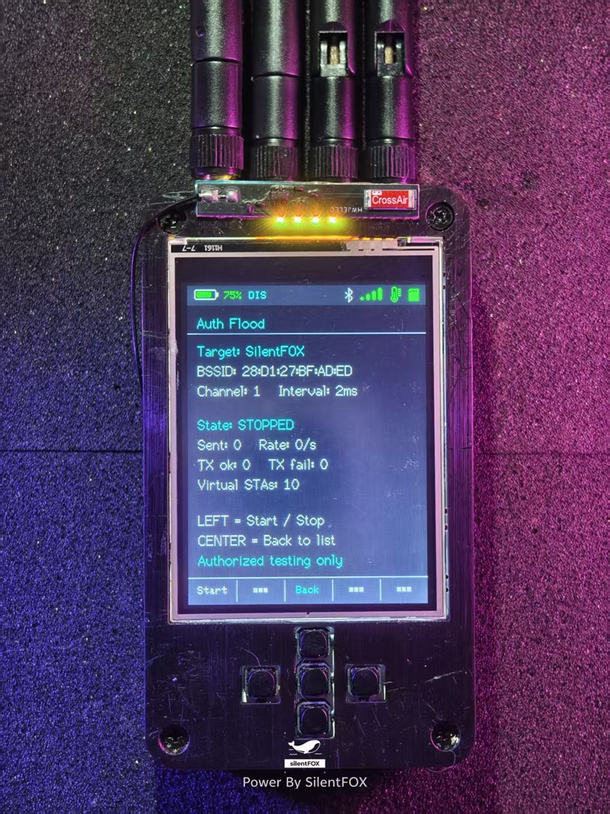

*Auth Flood target selection. All offensive modules are restricted to authorized testing.*

### DroneX on-device RID detector

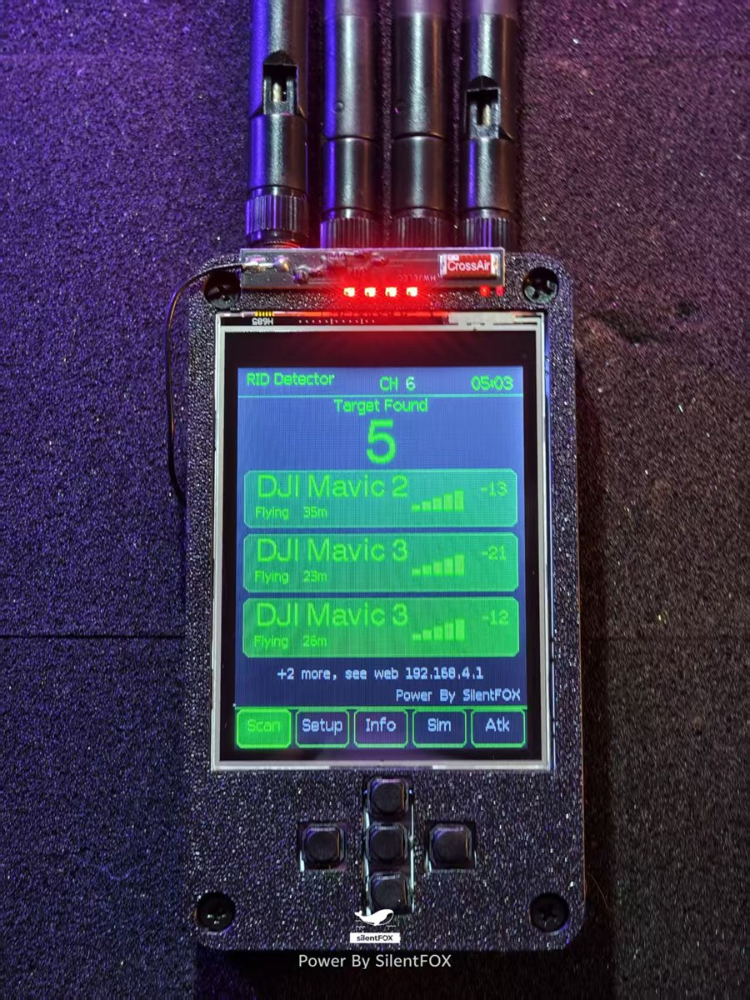

*DroneX RID Detector showing multiple DJI targets, distance, and RSSI. Scan, Setup, Info, Sim, and Atk tabs are available at the bottom.*

### DroneX Web UI

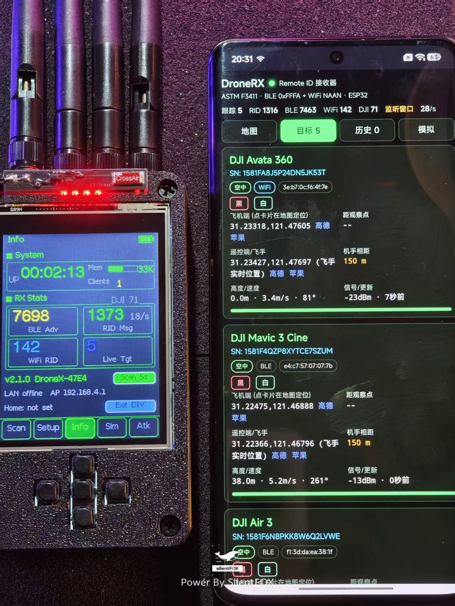

*The DroneX browser dashboard on a phone displays tracked targets, serial numbers, altitude, speed, and pilot position. The device keeps a local info page with heap, uptime, and packet counters.*

### DroneX tactical map

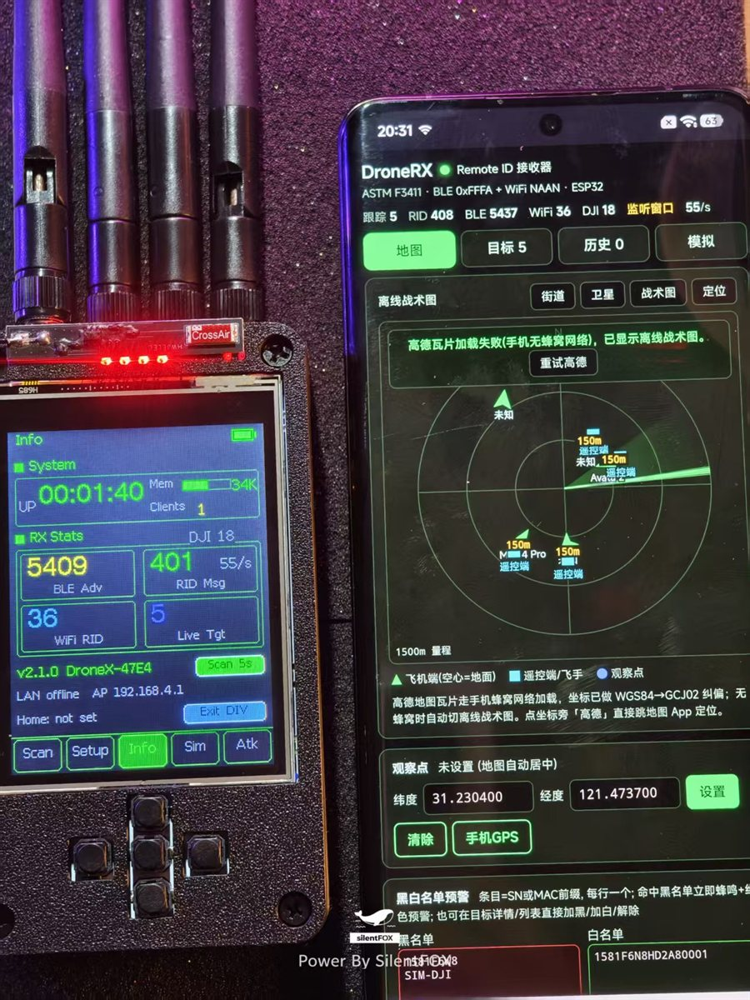

*The tactical map plots aircraft, pilots, and the observer. It falls back to an offline tactical view when map tiles cannot be loaded.*

---

## Hardware

### Specifications

| Item | Specification |
| --- | --- |
| MCU | ESP32-S3, dual-core, 240 MHz |
| Flash / PSRAM | 16 MB flash, 8 MB OPI PSRAM |
| Display | 2.8-inch ILI9341 TFT, 240 x 320, SPI |
| Touch | XPT2046 resistive touch controller |
| Wi-Fi | 2.4 GHz 802.11 b/g/n |
| Bluetooth | BLE 5.0 |
| 2.4 GHz | 3 x nRF24L01 modules |
| Sub-GHz | CC1101 transceiver |
| Infrared | IR receiver and IR transmitter, 38 kHz carrier |
| Optional | PN532 RFID/NFC over SPI, GNSS module |
| Storage | microSD card slot (FAT32) |
| Feedback | 4 x WS2812 RGB LEDs, buzzer |
| Power | IP5306 management IC at I2C address 0x75, 5 V / 2 A input or internal battery |
| Buttons | 5 keys through a PCF8574 I2C expander |
| Serial | USB CDC/JTAG at 115200 bps |

### Pin map

**Display and touch (HSPI / SPI3)**

| Signal | GPIO |
| --- | --- |
| TFT_MOSI | 35 |
| TFT_MISO | 37 |
| TFT_SCLK | 36 |
| TFT_CS | 17 |
| TFT_DC | 16 |
| Backlight | 7 (LEDC channel 0) |
| Touch CS | 18 |

**Shared SPI bus (FSPI / SPI2) for microSD, CC1101, and nRF24**

| Signal | GPIO |
| --- | --- |
| Shared SCK | 12 |
| Shared MISO | 13 |
| Shared MOSI | 11 |
| microSD CS | 10 |
| microSD card detect | 38 |
| CC1101 CS | 5 |
| nRF24 #1 | CE 15, CSN 4 |
| nRF24 #2 | CE 47, CSN 48 |
| nRF24 #3 | CE 14, CSN 21 |

**I2C bus**

| Device | Address | Pins |
| --- | --- | --- |
| IP5306 power management | 0x75 | SDA 8, SCL 9 |
| PCF8574 button expander | 0x20-0x27 (auto-detect) | SDA 8, SCL 9 |

**Buttons, IR, and indicators**

| Function | GPIO / bit |
| --- | --- |
| Button UP | PCF8574 bit 7 |
| Button DOWN | PCF8574 bit 5 |
| Button LEFT | PCF8574 bit 3 |
| Button RIGHT | PCF8574 bit 4 |
| Button SELECT | PCF8574 bit 6 |
| IR receiver | 21 |
| IR transmitter | 14 |
| Buzzer | 2 |
| NeoPixel data | 1 (4 LEDs) |
| USB D- / D+ | 19 / 20 |
| BOOT | 0 |

> Pin assignments are compile-time macros and can be overridden for custom boards. The V2 display is mounted 180 degrees rotated, so the firmware uses rotation 2.

---

## Menus and modules

### WiFi

| Tool | Description |
| --- | --- |
| Packet Monitor | Real-time channel waterfall across all 14 channels, optional PCAP logging to SD |
| Wi-Fi Scanner | Lists nearby access points with SSID, channel, RSSI, and security details |
| Beacon Spammer | Broadcasts forged SSIDs, either custom or randomized |
| WiFi Deauther | Sends deauthentication and disassociation frames to selected, authorized targets |
| Deauth Detector | Passive detection of deauthentication attacks |
| Captive Portal | Soft AP with captive DNS and a web server, supporting SSID cloning |
| Probe Flood | Floods probe requests to stress-test access point discovery |
| Hidden SSID Revealer | Forces hidden networks to expose their SSID |
| WPS Scanner | Identifies access points with WPS enabled |
| ARP Scanner | Maps IP and MAC addresses of devices on a joined network |
| Karma Attack | Learns SSIDs from probe requests and impersonates them to demonstrate auto-connect risks |

**Karma Attack notes:** the sniffer captures probe requests, stores up to 32 learned SSIDs, transmits beacons every 15 ms, switches the SoftAP to the most active SSID every 2.5 seconds, and redirects clients to a captive portal. Channel hopping runs every 800 ms. The firmware does not send deauthentication frames to the real access point.

### Bluetooth

| Tool | Description |
| --- | --- |
| BLE Scanner | Discovers visible and hidden BLE devices |
| BLE Sniffer | Tracks MAC address, RSSI, packet count, and last-seen time |
| BLE Spoofer | Broadcasts custom BLE advertisements |
| Sour Apple | Emulates Apple-style BLE advertisements and popups |
| BLE Jammer | Disrupts BLE and classic Bluetooth channels |
| BLE Rubber Ducky | Acts as a BLE HID keyboard and runs scripts from `/ducky` on SD |
| AirTag Spoofer | Broadcasts AirTag-style advertisements for Find My research |
| AirTag Sniffer | Detects nearby AirTag-like trackers |
| Skimmer Detect | Matches BLE signatures associated with known card skimmers |

**BLE Rubber Ducky:** create `/ducky/` on a FAT32 microSD card, place `.txt` scripts inside, insert the card, select a script, and run it with the target cursor in a text field you control.

### 2.4 GHz (nRF24)

| Tool | Description |
| --- | --- |
| 2.4 GHz Scanner | Scans 128 channels and visualizes activity beyond Wi-Fi (Zigbee, proprietary remotes) |
| Proto Kill | Transmits disruptive 2.4 GHz waveforms against Zigbee and neighboring ISM traffic |
| ESB Sniffer | Passively captures Enhanced ShockBurst packets |
| ESB Replay | Replays captured ESB packets |
| MouseJack Scan | Detects wireless mice and keyboards vulnerable to MouseJack |
| MouseJack Inject | Injects test keystrokes into vulnerable receivers you own |

The nRF24 and CC1101 paths share the FSPI bus with the SD card, so the firmware performs explicit chip-select arbitration before every transfer. The 2.4 GHz Scanner performs a full SPI lifecycle handover on entry, so it works immediately after a cold boot without visiting another radio feature first.

### Sub-GHz (CC1101)

| Tool | Description |
| --- | --- |
| Replay Attack | Learns and replays fixed-code remote controls |
| Sub-GHz Jammer | Transmits continuous or swept carriers across Sub-GHz ISM bands |
| Saved Profiles | Browses, loads, and transmits previously captured signals |
| De Bruijn / Brute Force | Iterates fixed-code space using a De Bruijn sequence |
| Jamming Detector | Receive-only monitoring for jamming and abnormal noise |

Replay Attack and Saved Profiles support all five CC1101 modulations: **2-FSK, GFSK, ASK/OOK, 4-FSK, and MSK**. A valid capture triggers a short buzzer confirmation (2000 Hz for RSSI events, 2600 Hz for DECODE events, 70 ms). Invalid or noisy signals are filtered before they can be saved or transmitted, and CC1101 communication has timeout protection so a missing module cannot hang the boot process.

### More

**Infrared**

| Tool | Description |
| --- | --- |
| IR Record | Learns IR remote buttons (air conditioners, TVs, and similar) |
| IR Saved Profiles | Reloads and replays saved IR captures |
| Universal Controller | Built-in brand code library with favorites |

IR captures and profiles are stored on the microSD card under `/ir/` and `/ir_profiles.json`. IR learning and replay require an inserted card.

**RFID / NFC (optional PN532, SPI)**

Eight tools are available: Card Reader, Card Clone, Dump, Decode Access, Erase, Jam Reader, Tag Disrupt, and Disrupt Emulate. Card Reader reports the UID and tag type (for example ISO14443A). Use only on tags you own. Avoid hot-plugging the microSD card during an RFID session because PN532 and the card slot may share the SPI bus.

**GPS (optional)**

| Tool | Description |
| --- | --- |
| GPS Wardriver | Logs GNSS position together with Wi-Fi and BLE observations to SD |
| Satellite Scanner | Displays satellites in view, signal strength, and fix diagnostics |

Satellite Scanner allocates a full-screen off-screen buffer of about 143 KB. If memory is fragmented after other radio features, it automatically falls back to direct rendering instead of failing.

**Drone (More > Drone)**

| Tool | Description |
| --- | --- |
| RID Scanner | Fast drone RID scanner over Wi-Fi channels 1-13 and BLE (device whitelist required) |
| RID Spoof | Multi-protocol RID transmitter simulating up to 12 aircraft (device whitelist required) |
| Drone Deauth | Passive drone-link identification followed by selective deauthentication of the Wi-Fi control link |
| Drone Jelly | 2.4 GHz carrier or sweep limited to 2400-2525 MHz, aimed at drone control and video links |

The whole Drone layer sits behind a single device authorization check made when **More > Drone** is opened; the individual tools inside it are not checked again.

**Drone Deauth** identifies targets passively from Wi-Fi management frames: Wi-Fi Remote ID vendor IEs (ASTM F3411 / GB 46750 OUI `FA:0B:BC` and `90:3A:E6`), DJI DroneID vendor IE OUI `26:37:12`, NAN / Public Action RID broadcasts, and — as weak evidence only — beacon SSIDs matching drone prefixes such as `DJI-`, `TELLO-`, or `MAVIC-`. When a client (phone or controller app) is observed associated with the target, three out of four frames are sent directly to it; otherwise all frames are broadcast. This only affects 802.11 links such as a drone's own access point. It has no effect on OcuSync / Lightbridge or other proprietary frequency-hopping links, and it cannot reach 5 GHz.

**Drone Jelly** offers two modes over the three nRF24 modules, which transmit on the same channel for higher combined output: **BARRAGE** covers channels 0-125 (2400-2525 MHz) and **FOCUS** covers channels 20-80 (2420-2480 MHz), where drone control and video links are most concentrated. It refuses to start while another nRF24 feature still owns the shared SPI bus and shows `BUS BUSY` instead.

### DroneX

See [DroneX and Remote ID](#dronex-and-remote-id).

### Tools

| Tool | Description |
| --- | --- |
| Serial Monitor | Mirrors serial output on the TFT at 115200 bps |
| Update Firmware | Web OTA and microSD firmware update entry points |
| Touch Calibrate | Four-corner XPT2046 calibration |
| SD File Manager | Browse, open, and manage files on the microSD card |

The two RID tools previously listed here now live in **More > Drone**.

### Settings and About

Settings covers theme colors, display brightness, NeoPixel effects, background auto-scan, and saving the configuration. Settings are written to NVS namespace `esp32div` first and mirrored to `/config/settings.json` on SD when a card is present, so settings survive power loss even without a card. LittleFS is not used.

About shows the firmware version, build information, and project credits.

---

## DroneX and Remote ID

DroneX is the flagship continuous monitoring platform. It performs time-sliced BLE and Wi-Fi Remote ID detection, merges observations into stable targets, and provides on-device and browser-based management.

### Detection

- Decodes **ASTM F3411**, **GB 46750-2025**, and **DJI proprietary DroneID**
- Displays serial number, operator registration number, position, altitude, horizontal and vertical speed, heading, and pilot location
- Merges BLE and Wi-Fi observations of the same aircraft
- Marks a target inactive after 5 seconds without an advertisement and removes it after 30 seconds
- Supports observer mode: send `HOME,<latitude>,<longitude>` over serial to set a protected point; range and bearing are then shown per target and persisted across reboots

### Alerts, lists, and logs

- New target: audible alert and red RGB indication
- Emergency, fault, and blacklisted targets trigger visible alarms on screen and in the browser UI
- Black and white lists support serial-number or MAC-prefix entries
- Each target creates an SD card track session for later route review
- A built-in simulator can inject virtual targets with `SIM START` and `SIM STOP` for demonstrations and training without affecting real detection

### Browser dashboard

Connect to the device hotspot and open `http://192.168.4.1`:

| Setting | Default |
| --- | --- |
| Hotspot SSID | `DroneX-xxxx` |
| Hotspot password | `dronerx88` |
| Dashboard URL | `http://192.168.4.1` |

The dashboard shows live statistics, a target list, a map, alert state, and editable lists and settings. All HTTP responses use `Connection: close`, and static asset paths are versioned to avoid stale browser caches. When map tiles cannot be fetched, the UI falls back to an offline tactical view.

**STA mode:** the settings page can store a router SSID and password. The device joins the router while keeping its own hotspot. Access the dashboard from the same LAN at `http://dronerx.local` or the device STA IP; internet access remains available for map tiles. Once STA is connected, the firmware closes its own hotspot to free about 30 KB of heap and avoid channel conflicts, then reopens it automatically if STA remains down for 15 seconds. A 10-second quiet period prevents rapid toggling. A manual AP override is available on the Info tab and through the `APCTL` serial command.

### DroneX activation

DroneX requires a paid license. The device ID (Wi-Fi STA MAC address) is shown on the lock screen and in the browser. A license is bound to that MAC address and signed with ECDSA over secp256r1; only the public key is embedded in the firmware, so copying a license to another device fails verification.

Activation methods:

| Method | Procedure |
| --- | --- |
| Web | Connect to the hotspot, open `192.168.4.1`, paste the Base32 license, and submit |
| SD card | Save the license as a plain ASCII/UTF-8 text file named `dronex.lic` in the card root, then power on with the card inserted |
| Serial | Send `DRONEXKEY,<license>` at 115200 bps |

A successful activation is stored permanently and revalidated on every boot.

### RID Scanner

RID Scanner is a zero-configuration scanner for field checks. It alternates between Wi-Fi channels 1-13 and BLE advertising, then lists active targets with serial number, latitude/longitude, RSSI, and source interface. Protocol counters show management frames, BLE, GB, DJI, and ASTM traffic. A target turns gray after 5 seconds without an advertisement and is removed after 30 seconds. Press SELECT to exit.

### RID Spoof

RID Spoof (formerly RID Sim) turns the device into a virtual drone fleet. It simulates **10 aircraft by default and up to 12**, each with a unique identity, transmitting standard RID data over Wi-Fi beacons and BLE advertising.

| Bearer | Protocol |
| --- | --- |
| Wi-Fi beacon | ASTM F3411, dual OUI |
| Wi-Fi beacon | GB 46750-2025 |
| Wi-Fi beacon | DJI proprietary DroneID |
| BLE advertising | ASTM F3411 service data (0xFFFA) |

Each aircraft is placed at a different bearing, starting at 300 m and increasing by 80 m per aircraft, with incremental altitude, speed, and heading. Identities are randomized on boot and include model names such as Mini 2 and Mavic Air 2. RID Spoof emits RID frames that carry these identities; it does not emulate OcuSync radio links.

Serial commands while RID Spoof is running:

| Command | Action |
| --- | --- |
| `start` / `stop` | Start or stop transmission |
| `status` / `list` | Show status or list all virtual identities |
| `regen` | Regenerate the virtual fleet |
| `n <1..12>` | Set the number of simulated aircraft |
| `pos <lat> <lon> [alt]` | Move the virtual fleet to a coordinate |
| `wifi <0\|1>` | Enable or disable all Wi-Fi RID output |
| `astm <0\|1>` / `gb <0\|1>` / `dji <0\|1>` | Enable or disable individual Wi-Fi protocols |
| `ble <0\|1>` | Enable or disable BLE output |
| `exit` | Leave RID Spoof |

---

## HaleHound

HaleHound is a self-contained suite of 14 wireless experiment modules, implemented in its own namespace with a shared UI, button handling, and SPI arbitration. Open it from **More > HaleHound**.

| Module | Purpose |
| --- | --- |
| Radio Test | Checks nRF24 #1-#3, CC1101, PN532 firmware, GPS satellite count, and fix time |
| IOT Recon | Passive Wi-Fi AP scan with vendor identification and default-credential hints |
| Deauther | Targeted deauthentication with channel hopping, reason-code selection, and client detection |
| Auth Flood | Authentication request flood with a four-column network list (SSID / channel / RSSI / encryption), a large START/STOP control, a 56-segment rate bar and six live counters |
| Stations | Connected client scanner with AP filter, channel lock, RSSI sort, single-row pinning, and optional deauth handoff |
| Predator | BLE GATT honeypot that advertises discoverable services |
| WhisperPair | Passive Google Fast Pair (0xFE2C) advertisement scanner with Model ID lookup |
| Airoha Race | Detects BLE devices advertising the Airoha RACE service |
| SkeletonKey | Scans connectable BLE devices, counts services and characteristics, then disconnects |
| Scream | Rotates BLE advertisement payloads and names (8 names, 40 ms cycle) |
| Guardian | Passive monitoring of one AP channel with deauthentication and disassociation alerts |
| Spectrum | Channel activity bar chart (802.11 frame counts) plus BLE advertiser count |
| EAPOL Capture | Passive WPA/WPA2 four-way handshake capture, exportable as PCAP |
| RFID Classic | PN532 target-mode MIFARE Classic 1K UID emulation |

**Notes:**

- Stations hops across channels 1-13 by default. You can lock a single channel or select a specific access point; results are sorted by signal strength, and one row can be pinned while scanning continues. The deauth handoff only runs for a client whose access point is known — without that association it is refused.
- If the device hotspot has associated clients, changing channel fails at the driver level. The firmware briefly detaches the hotspot client and retries; if the channel still cannot be set, it stays on the real channel and tells you so instead of pretending to scan elsewhere.
- Frame capture re-initialises promiscuous mode in a fixed order (off, set filter, register callback, on, read back) and verifies the result, so a scan no longer appears to run while silently capturing nothing.
- Guardian is receive-only. An alert appears when deauthentication plus disassociation frames reach 20 within a 10-second window.
- EAPOL Capture only records handshakes from clients that reconnect naturally; it does not disconnect clients or crack keys. Save raw frames to a `.pcap` file for Wireshark.
- Spectrum displays frame counts, not calibrated RF energy. The SoftAP follows the scanned channel and connected clients may briefly drop.
- RFID Classic emulates UID-level behavior only; authenticated sectors are not answered, and the `0x8C` raw command path has not been hardware-validated.
- HaleHound modules are compile-validated but were not all hardware-validated at release time.

---

## Serial console

Connect over USB at **115200 bps** with newline or CRLF line endings. Commands work from any firmware state. Serial input is ignored for the first 5 seconds after boot to avoid startup noise from USB CDC enumeration.

### System

| Command | Action |
| --- | --- |
| `reboot` / `restart` / `rst` | Reboot immediately; pending settings are saved first |
| `help` / `?` | Print command help |
| `version` / `ver` | Print firmware version and build time |

### Diagnostics

| Command | Action |
| --- | --- |
| `battery` / `bat` | Battery voltage and percentage |
| `status` | Battery voltage, free heap, and uptime |
| `heap` | Free heap and largest free block |
| `gpioscan` | Scan GPIOs and print a status table |

### Wi-Fi status

| Command | Action |
| --- | --- |
| `ssid` | Current SoftAP SSID and IP address |
| `sta` | STA connection state, SSID, RSSI, and IP address |

### DroneX

| Command | Action |
| --- | --- |
| `DRONEXKEY,<license>` | Activate DroneX with a Base32 license |
| `HOME,<lat>,<lon>` | Set the observer position |
| `SIM START` / `SIM STOP` | Start or stop the target simulator |
| `APCTL` | Show AP override state |
| `APCTL auto` / `ap` / `sta` | Restore automatic AP control, force AP on, or force AP off |
| `APCTL toggle` | Cycle the AP override state |
| `help` | Show DroneX-specific commands |

`gpioscan` labels reserved pins (display, SPI, SD, I2C, USB, PSRAM/flash, serial, boot) and reads the remaining pins with internal pull-ups, reporting HIGH or LOW.

---

## Web interfaces

### DroneX dashboard

- Address: `http://192.168.4.1` on the device hotspot, or `http://dronerx.local` in STA mode
- Default hotspot: `DroneX-xxxx`, password `dronerx88`
- Features: live statistics, target list, map and tactical view, alerts, black/white lists, settings

### Web OTA

1. Connect the device to the same LAN as your computer through **Settings > WiFi** (STA mode).
2. Open **Update Firmware > Web OTA** and note the address shown on screen.
3. Browse to `http://<device-ip>/`, then log in with the default credentials `admin` / `div` (or your changed password).
4. Select a `.bin` file and press **Update**. The device reboots when flashing completes.

> **Web OTA needs a two-slot partition table.** The update is written into the second application slot, so the device must already carry the `default_8MB` layout with both `app0` (`ota_0`) and `app1` (`ota_1`). Web OTA cannot create that layout — if the device was flashed with a single-slot (no-OTA) scheme, the update will abort and the device will restart on the old firmware. Recover by flashing the complete image at `0x0` once; see [Flashing](#flashing).

Do not interrupt power during the update; the bootloader falls back to the previous slot if the new image is incomplete. The progress bar is an estimate because the browser does not send a content length.

---

## Licensing and restricted features

Two menu layers are restricted: **More > Drone** and **More > HaleHound**.

- Both menu entries are always visible and can always be opened.
- On a device that is not authorized, opening the layer shows a single English license notice page instead of its contents.
- The check is made once, when the layer is opened. The tools inside a layer (including RID Scanner and RID Spoof) are not checked again.
- Press **LEFT** / **SELECT**, or tap **Back**, to return to the previous menu.
- Authorization is bound to the device Wi-Fi STA MAC address.
- DroneX uses a separate paid ECDSA license; the two mechanisms are independent.

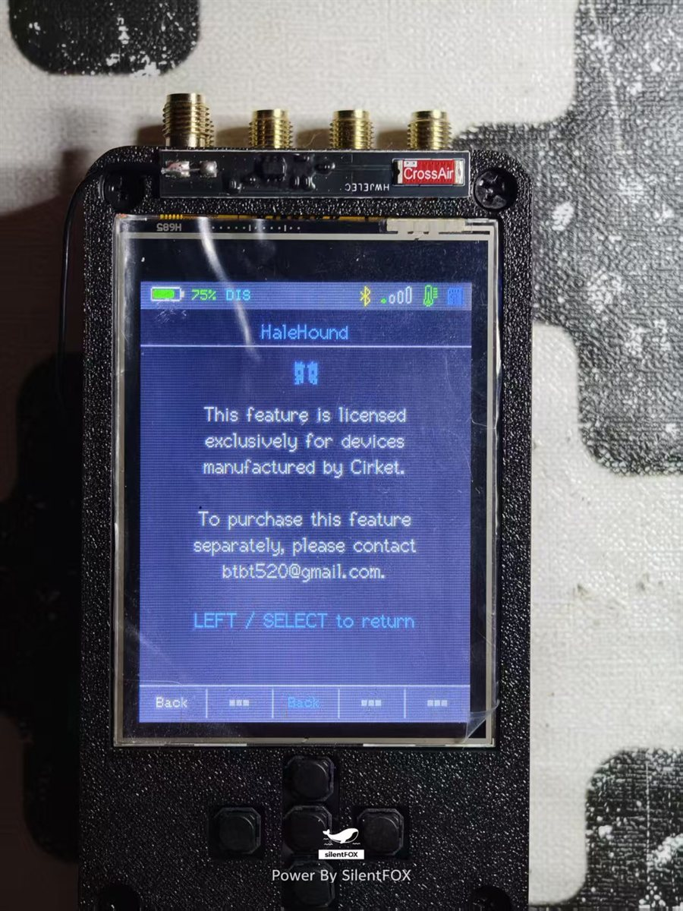

*The license notice page used by the Drone and HaleHound layers on unauthorized devices.*

---

## Flashing

Firmware binaries are published on the [Releases](https://github.com/silentfox2023/ESP32-DIV/releases) page. Release assets contain **binaries only**; source code is not included in release assets.

> **Always prefer the complete image.** In-device updates (Web OTA and SD Card Update) only work when the partition table on the device has two application slots (`app0` / `ota_0` and `app1` / `ota_1`). The complete image carries that table; the application-only image does not. If a device was ever flashed with a single-slot (no-OTA) layout, an in-device update cannot repair it — it aborts and the device reboots back into the old firmware after a couple of seconds. Flashing the complete image at `0x0` once restores the two-slot layout, after which Web OTA and SD Card Update work normally. Repeating the in-device update will never fix this.

### Release files

| File | Purpose | Flash address |
| --- | --- | --- |
| `ESP32-DIV-V2-v1.9.0-full-16MB.bin` | **Recommended.** Complete image: bootloader, partition table (two application slots), OTA data, and application | `0x0` |
| `ESP32-DIV-V2-v1.9.0-app.bin` | Application image only, for a device that already has the two-slot layout | `0x10000` |
| `sha256sums.txt` | SHA-256 checksums | - |

### esptool

Complete image (recommended for a new device, after a full erase, or to restore a device that cannot update itself):

```
esptool.py --chip esp32s3 -p COMx -b 921600 write_flash 0x0 ESP32-DIV-V2-v1.9.0-full-16MB.bin
```

Application-only update (device must already use the `default_8MB` two-slot layout):

```
esptool.py --chip esp32s3 -p COMx -b 921600 write_flash 0x10000 ESP32-DIV-V2-v1.9.0-app.bin
```

Flashing from **Arduino IDE** works as well: enable **Erase All Flash Before Sketch Upload** and select the 16 MB flash size with the two-OTA-slot partition scheme used by this release.

### Flash Download Tool

| File | Offset | Required |
| --- | --- | --- |
| Bootloader | `0x0` | Yes for a blank or erased device |
| Partition table | `0x8000` | Yes |
| Application | `0x10000` | Yes |

Use **DIO** flash mode and 40 MHz SPI speed. QIO or QOUT can produce a white screen with no serial output on ESP32-DIV V2 hardware. The full 16 MB image already contains all three parts and only needs the single `0x0` write.

### microSD update

1. Format a microSD card as FAT32.
2. Copy the application `.bin` to the card root and rename it `firmware.bin`.
3. Insert the card, power on, open **Update Firmware > SD Card Update**, select the file, and start the update.
4. The device reboots when flashing completes; the original file is renamed as a backup.

Like Web OTA, SD Card Update writes into the second application slot and therefore requires the two-slot partition table to be present already. It cannot add `app1` to a device that does not have it.

### Partition layout

| Partition | Offset | Size |
| --- | --- | --- |
| NVS | `0x9000` | `0x5000` |
| OTA data | `0xe000` | `0x2000` |
| app0 | `0x10000` | `0x330000` |
| app1 | `0x340000` | `0x330000` |
| SPIFFS | `0x670000` | `0x180000` |
| coredump | `0x7F0000` | `0x10000` |

Both `app0` and `app1` are required for in-device updates. Writing only the application at `0x10000` leaves the existing partition table untouched, so a single-slot device stays single-slot. The complete image at `0x0` rewrites the partition table together with the application and is the only way to guarantee the layout above.

> These images target **16 MB** ESP32-DIV V2 hardware. Do not flash them to 4 MB or 8 MB devices.

---

## Quick start

1. Flash the complete image at `0x0` (recommended). Web OTA and SD Card Update can be used later, but only on a device that already has the two-slot partition table — see [Flashing](#flashing).
2. Power on and wait for the main menu. The status bar shows battery, charge state, Wi-Fi, and BLE indicators.
3. Use the touchscreen or the five buttons: up/down to move, SELECT to confirm, LEFT to go back.
4. For RID work, open **Tools > RID Scanner** for a quick scan, or **DroneX** for continuous monitoring.
5. For DroneX browser access, join the `DroneX-xxxx` hotspot with password `dronerx88` and open `http://192.168.4.1`.
6. Insert a FAT32 microSD card for PCAP logs, IR profiles, Ducky scripts, RID tracks, firmware updates, and settings mirroring.
7. Open **Settings** to adjust brightness, theme, NeoPixel effects, and background scanning.

---

## Known limitations

- **Single radio:** Wi-Fi and BLE features are mutually exclusive while active. A STA connection locks the radio to the router channel, so full-channel Wi-Fi RID scanning is unavailable in STA mode.
- **STA and Wi-Fi RID:** while STA is connected, Wi-Fi promiscuous sniffing is disabled because modem sleep and promiscuous mode conflict and cause severe packet loss. BLE RID detection continues normally. Use AP mode for Wi-Fi RID detection.
- **RID prerequisites:** drones transmit GB 46750-2025 RID only after obtaining a GNSS fix, and Chinese-standard broadcasts apply to China-region firmware. Outdoor testing is required.
- **RID bands:** 5.8 GHz is not supported by ESP32-S3 hardware. BLE 5 extended advertising is not supported; only legacy BLE advertising is decoded.
- **Spectrum:** shows 802.11 frame counts rather than calibrated RF energy.
- **RFID Classic:** UID-level emulation only; authenticated sectors are not answered, and the `0x8C` command path is not hardware-validated.
- **HaleHound:** compile-validated; not every module has been hardware-validated.
- **EAPOL Capture:** purely passive and requires a client to reconnect naturally.
- **In-device updates:** Web OTA and SD Card Update require the two-slot partition table to be present already; they write into the inactive slot and alternate on each update. On a device with a single-slot layout they fail and the device reboots on the old firmware — flash the complete image at `0x0` once to recover.
- **Battery and buzzer:** the buzzer shares a GPIO with the battery voltage divider on some hardware revisions; use it as an optional feature.

---

## FAQ

**The screen is white and there is no serial output.**
Flash mode mismatch. Use **DIO**, not QIO or QOUT.

**Web OTA reboots immediately after pressing Update, and the device comes back on the old firmware.**
The device has a single-slot partition table, so the update has nowhere valid to write. Web OTA and SD Card Update cannot fix this themselves. Flash `ESP32-DIV-V2-v1.9.0-full-16MB.bin` at `0x0` once (or upload from Arduino IDE with **Erase All Flash Before Sketch Upload** enabled); afterwards in-device updates work normally. See [Flashing](#flashing).

**A restricted feature shows a license page.**
The device MAC is not in the authorized list, or the DroneX license is missing. Drone and HaleHound share the MAC whitelist; DroneX uses a separate ECDSA license.

**DroneX finds no drones indoors.**
RID requires an outdoor environment and a GNSS fix on the aircraft. Move outdoors and keep the device in AP mode for Wi-Fi RID reception.

**The hotspot disappeared after connecting to a router.**
Expected. DroneX closes its own hotspot in STA mode. Use the Info tab AP button or `APCTL toggle` to force it back on.

**IR recording does not work without an SD card.**
IR profiles are stored on the microSD card. Insert a FAT32 card.

**Why do I not see my own phone's MAC address in a client scan?**
Modern phones use a private, randomly generated MAC address for each Wi-Fi network by default. The address on air is not the hardware address printed in the phone settings, so it will never match. This is operating system behaviour, not a limitation of the device.

**Why does the heartbeat show `sniff=0` in STA mode?**
Wi-Fi promiscuous sniffing is intentionally disabled while STA is connected, as described in Known limitations. BLE RID remains active.

---

## Documentation and credits

- Upstream open-source project and wiki: [cifertech/ESP32-DIV](https://github.com/cifertech/ESP32-DIV)
- Firmware and product documentation for this edition: [silentfox2023/ESP32-DIV](https://github.com/silentfox2023/ESP32-DIV)
- Cirket: [https://dz-rf.com/](https://dz-rf.com/)
- GB 46750-2025 civilian unmanned aircraft system operational identification specification

Hardware design credits belong to the upstream ESP32-DIV project. DroneX, RID tooling, HaleHound, and the SilentFOX firmware customizations are maintained by SilentFOX.

Contact: btbt520@gmail.com

---

## License

Distributed under the MIT License. See [LICENSE](LICENSE) for details.
